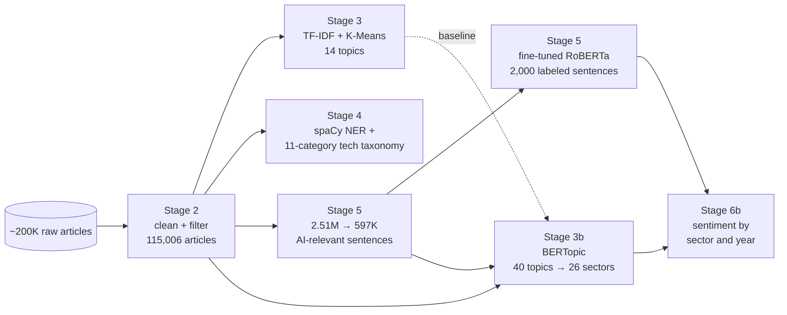
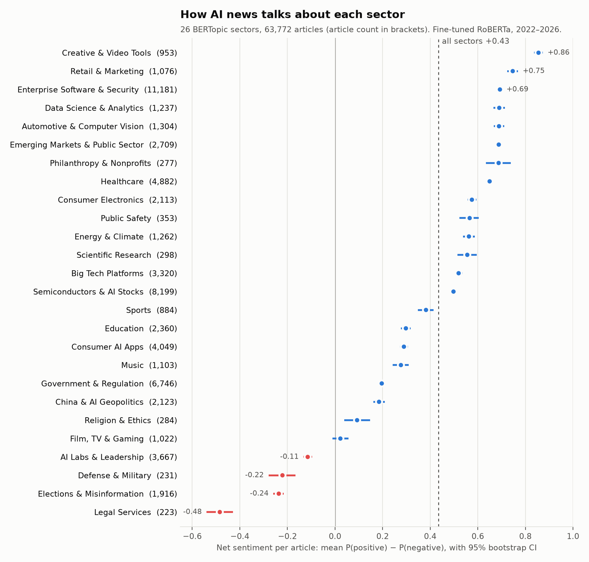

# AI News Sentiment by Industry

> ~200K AI news articles → cleaning → **BERTopic** topics (against a TF-IDF + K-Means baseline) → **spaCy** entities → fine-tuned **RoBERTa** sentiment → sentiment by sector and year.


-0.163%20%E2%86%92%200.228-00aa55?style=flat-square&labelColor=2a323d)


-00aa55?style=flat-square&labelColor=2a323d)


Which industries does the press expect AI to change, and does it see that change as good or bad? This project answers that from about 200,000 AI news articles published between 2022 and 2026. The original course pipeline grouped articles with TF-IDF + K-Means and scored sentences with a fine-tuned RoBERTa model. The upgrade re-does the topic model with **BERTopic**, measures both models on the same documents, and joins the sentiment scores to the new sectors. It also puts the sentiment model next to simple baselines, with confidence intervals.



Stages 1–6 are the original notebooks. Stage 3b, the Stage 5 evaluation and Stage 6b are scripts in `scripts/` that read the notebook outputs. Every number in this README that comes from those scripts was re-run on 2026-10-27.

## Key findings

* **BERTopic gives more coherent and more even topics.** On the same 95,467 articles it raises NPMI coherence from 0.163 to 0.228, and its largest topic holds 11.7% of articles instead of 32.1%. It also separates 26 sectors where K-Means had 12 industry labels.
* **BERTopic's sector labels are more specific, not more often right.** In a blind check of 200 articles judged by an LLM, its label was correct and specific for 66.0% of articles against 44.5% for K-Means. Both were wrong on about 14%.
* **The K-Means general label hid opposite views.** Its "Software / AI Platforms" label holds 40,507 articles with an average net sentiment of +0.29. Split by BERTopic sector, those articles range from −0.48 (Legal Services) to +0.77 (Data Science & Analytics).
* **The press is most negative about AI in legal services (−0.48), elections (−0.24), defense (−0.22) and AI labs themselves (−0.11).** It is most positive about creative tools, retail and enterprise software. Removing press releases barely changes this ranking (Spearman 0.99).
* **The fine-tuned model clearly beats an off-the-shelf sentiment model, and beats TF-IDF by 7.7 points of accuracy.** Its macro F1 gain over TF-IDF is not significant on 300 test sentences.
* **The first BERTopic run found a data-quality problem K-Means had missed.** On full page text, several topics were single-site templates, such as crypto price pages, a trading-robot shop and press-wire menus. The final run removes them.

## Pipeline

| Stage | Where | What it does | Output |
|---|---|---|---|
| 1 EDA | `NLP_Final_Project_01_EDA.ipynb` | Languages, dates, lengths, missing values, duplicates; manual sample review | profiling notes |
| 2 Clean | `NLP_Final_Project_02_Clean_Filter.ipynb` | HTML/Unicode clean-up, paragraph scoring to keep body text, quality filters, dedup by URL and text | 115,006 articles |
| 3 Topics | `NLP_Final_Project_03_topic_modeling.ipynb` | TF-IDF (346 stopwords, 20K features) + K-Means, K chosen by silhouette | 14 topics, 12 industry labels |
| 3b Topics, upgraded | `scripts/bertopic_topics.py`, `scripts/map_industries.py` | MiniLM embeddings → UMAP → HDBSCAN → c-TF-IDF, scored against K-Means | 40 topics → 26 sectors |
| 4 Entities | `NLP_Final_Project_04_entity_extraction.ipynb` | spaCy `en_core_web_sm` ORG entities + alias map; keyword taxonomy of 11 technology and impact categories | `org_dict.csv`, `tech_dict.csv` |
| 5 Sentiment | `NLP_Final_Project_05_sentiment_train_apply.ipynb` | 2.51M sentences → 597K AI-relevant; 2,000 labeled; RoBERTa-base fine-tuned; all 597K scored | sentence and article scores |
| 5 Evaluation | `scripts/sentiment_baselines.py` | Same split; baselines, per-class scores, bootstrap CIs | `results/sentiment_eval/` |
| 6 Visuals | `NLP_Final_Project_06_Visualization.ipynb` | Sentiment over time by topic, company and technology | figures |
| 6b Sector sentiment | `scripts/sector_sentiment.py` | Joins sentence sentiment to the 26 sectors; press-release check; 2023 → 2025 change | `results/sector_sentiment/` |

## Results

### Topic model: BERTopic against K-Means

Both models are scored on the same 95,467 articles with `gensim` coherence over each topic's top 10 words. Diversity is the share of unique words across all topics' top-10 lists.

| Model | Topics | NPMI | C_v | Diversity | Largest topic |
|---|---|---|---|---|---|
| TF-IDF + K-Means (Stage 3) | 14 | 0.163 | 0.721 | 0.874 | 32.1% |
| BERTopic, all topics | 103 | 0.229 | 0.706 | 0.605 | 6.5% |
| **BERTopic, merged to 40 (used)** | 40 | **0.228** | 0.698 | 0.706 | **11.7%** |
| BERTopic, merged to 14 | 14 | 0.309 | 0.754 | 0.686 | 63.6% |

C_v is slightly lower for BERTopic. Diversity is also lower, because related topics share words such as *chatgpt* and *openai*. The 14-topic merge has the best coherence but puts 63.6% of articles in one topic, so it was not used. After outlier reassignment, 29.8% of articles still belong to no topic.

The 40 topics were labeled by hand from their top words, sample titles and top domains. `results/bertopic_v2/topic_industry_map.csv` records the evidence for each label. This gave 34 content topics in 26 sectors, plus 6 noise topics:

- press-wire menus
- comment forms
- insurance-quote spam
- a citation digest
- a tabloid template
- Indian news where "AI" means Air India

Of the 40,536 articles K-Means placed in its general label, BERTopic moved 30.6% to a sector outside technology. The largest were Government & Regulation, Education and Healthcare. Education had no label of its own in Stage 3.

<details>
<summary>How the corpus for BERTopic was built</summary>

A first run on the full cleaned text (136 topics) clustered several sites by their page template instead of by subject:

- PR Newswire navigation menus
- MEXC crypto price pages
- mql5 trading-robot listings
- an AI-wallpaper gallery
- Coursera course pages
- a job board

K-Means had marked the wallpaper gallery as noise and put 58% of the MEXC pages in a crypto topic. However, it placed most mql5, Coursera and job-board pages in content topics.

The final run makes three changes:

- It removes five listing and storefront domains.
- It represents each article by its cleaned title plus its AI-relevant sentences from Stage 5.
- It strips repeated site names from titles.

| Corpus step | Articles |
|---|---|
| Cleaned corpus (Stage 2) | 115,006 |
| After removing listing domains | 109,576 |
| With at least one AI-relevant sentence (final) | 95,467 |

Settings: `all-MiniLM-L6-v2`; UMAP with 15 neighbors, 5 dimensions and cosine distance; HDBSCAN with minimum cluster size 150. c-TF-IDF uses the Stage 3 stopword list. Outliers are reassigned by c-TF-IDF similarity (threshold 0.1). Seed 42.

</details>

### Sentiment by sector



Each article's score is the mean, over its AI-relevant sentences, of P(positive) − P(negative), so it runs from −1 to +1. A sector's score is the mean over its articles, and the 95% interval is bootstrapped over articles. The 2,000 hand-labeled sentences are left out. The chart covers the 63,772 articles that have a sector. All values are in `results/sector_sentiment/sector_sentiment.csv`.

**Inside the K-Means general label** (40,507 articles, average +0.29):

| BERTopic sector | Articles | Net sentiment |
|---|---|---|
| Legal Services | 185 | −0.48 |
| Elections & Misinformation | 966 | −0.25 |
| Healthcare | 1,011 | +0.52 |
| Data Science & Analytics | 1,003 | +0.77 |

**Press releases.** Press releases are written to be positive, and sectors with more of them do score higher: Spearman 0.75 across sectors. However, removing the 7.8% of articles from press-release wires leaves the ranking almost unchanged (Spearman 0.99 between the two rankings). Creative & Video Tools contains many vendor landing pages, so its top score partly reflects marketing copy.

**Change from 2023 to 2025.** This covers sectors with at least 100 articles in both years. 13 of the 20 intervals exclude zero; they are not corrected for multiple comparisons.

| Sector | Change [95% CI] |
|---|---|
| Energy & Climate | −0.17 [−0.23, −0.11] |
| Music | −0.16 [−0.25, −0.08] |
| China & AI Geopolitics | −0.13 [−0.19, −0.07] |
| Creative & Video Tools | +0.14 [+0.08, +0.21] |
| Film, TV & Gaming | +0.15 [+0.07, +0.23] |
| Big Tech Platforms | +0.17 [+0.13, +0.21] |

Creative & Video Tools grew from 148 to 586 articles over those years, so its rise may reflect a different mix of sources.

### Sentiment model

2,000 sentences were pre-labeled with the OpenAI API and then reviewed, using three classes: *positive*, *negative* and *uncertain/mixed*. They were split 70/15/15 with stratification and seed 42. `roberta-base` was fine-tuned for 3 epochs (learning rate 2e-5, batch size 16, max length 128), keeping the epoch with the best validation macro F1.

All models below are scored on the same 300 test sentences: 174 positive, 78 uncertain/mixed and 48 negative. Brackets are 95% bootstrap intervals.

| Model | Accuracy | Macro F1 |
|---|---|---|
| Majority class (always *positive*) | 58.0% | 0.245 |
| Off-the-shelf sentiment model, no fine-tuning (`cardiffnlp/twitter-roberta-base-sentiment-latest`) | 63.3% [57.7, 68.7] | 0.613 [0.550, 0.673] |
| TF-IDF + logistic regression (tuned on validation) | 74.7% [69.7, 79.3] | 0.697 [0.639, 0.753] |
| **Fine-tuned RoBERTa-base** | **82.3% [78.3, 86.7]** | **0.764 [0.709, 0.818]** |

The fine-tuned model gains 7.7 points of accuracy over TF-IDF (paired 95% CI 2.0 to 13.3). Its macro F1 gain of 0.067 (−0.003 to 0.135) is not significant on 300 sentences. The off-the-shelf model labels many positive sentences as neutral: its positive recall is 62%.

Per class, RoBERTa reaches F1 0.929 on *positive*, 0.718 on *negative* and 0.644 on *uncertain/mixed*. Most errors fall between *uncertain/mixed* and *negative*. Positive and negative are almost never confused (1 of 222 sentences).

### Industry label check

Are BERTopic's sectors actually better labels? The check used 200 random articles that both models assign to a sector. Each article was shown with its two labels as A and B, in random order. Each label was judged *correct and specific*, *correct but too general*, or *wrong*, and the better label was chosen.

**The judge was an LLM (Claude), not a human annotator.** It saw only the title, the domain and the first 500 characters of the cleaned article. It did not know which model produced which label. The answer key is kept apart from the sheet (`scripts/make_label_check.py`, `scripts/score_label_check.py`).

| | BERTopic sector | K-Means industry |
|---|---|---|
| Correct and specific | **66.0%** [59.5, 72.5] | 44.5% [37.5, 51.5] |
| Correct (specific or too general) | 85.5% [80.5, 90.0] | 86.5% [81.5, 91.0] |
| Wrong | 14.5% | 13.5% |
| Preferred head-to-head | **98** | 34 |

The head-to-head row excludes 68 ties; a sign test gives p = 2e-8.

BERTopic's label is specific 21.5 points more often (paired 95% CI 13.5 to 30.0). It is not right more often, though: both models are wrong on about 14% of articles. Most of K-Means's *too general* labels (49 of 59) are its "Software / AI Platforms" label, and most of BERTopic's wrong labels are Government & Regulation (9 of 29). The check covers only articles that both models label. BERTopic leaves 29.8% of articles without a sector, while K-Means labels 95% of them.

## Run it

The notebooks run in order (01 → 06), and each reads the previous stage's Parquet/CSV files. Notebook 05 was written for Google Colab; change `DATA_DIR` to run it locally. The scripts need the corpus and the Stage 5 sentence file under `data/`:

```bash
pip install -r requirements-bertopic.txt
python scripts/bertopic_topics.py --source clean --out results/bertopic          # first run, full text
python scripts/bertopic_topics.py --source hybrid --reduce-to 40,14 --out results/bertopic_v2
python scripts/map_industries.py
python scripts/make_label_check.py         # blind sheet under data/labeling/, then fill it in
python scripts/score_label_check.py --judge "LLM (Claude), blind to which model produced each label"
python scripts/sentiment_baselines.py
python scripts/sector_sentiment.py
python scripts/plot_sector_sentiment.py
```

A BERTopic run takes about 7–13 minutes on an Apple M-series laptop with MPS. Embeddings are cached, so later runs are faster. The other scripts take under a minute each.

```
├── NLP_Final_Project_0{1..6}_*.ipynb   # the original six stages
├── scripts/                           # Stage 3b, label check, Stage 5 evaluation, Stage 6b, chart
├── results/
│   ├── bertopic/                      # first BERTopic run (site-template topics)
│   ├── bertopic_v2/                   # final run: metrics, topic tables, sector map
│   ├── sentiment_eval/                # baselines, per-class scores, confusion matrix
│   ├── sector_sentiment/              # sector and year tables
│   └── label_check/                   # blind label check scores
├── docs/sector_sentiment.png
├── sent_annotation_labeled_2000.csv   # the 2,000 labeled sentences
├── topic_summary.csv, industry_summary.csv, macro_topic_summary.csv   # Stage 3 outputs
└── org_dict.csv, tech_dict.csv         # Stage 4 outputs
```

## Data source

The news corpus was **provided by the course instructor** for UChicago ADSP 32018. It is not redistributed here, and neither are document-level outputs that contain its URLs and titles. Only aggregate tables are published. The OpenAI API was used only to pre-label the 2,000 annotation sentences; it is not needed to reproduce training or the scripts.

## Design notes and limits

* **Small labeled set.** The sentiment model is trained on 2,000 sentences, and its test set has 300. The intervals above show how much that limits precision.
* **Biased labeled set.** All 2,000 labeled sentences have the highest priority score, so they carry more information than the average of the 597K sentences the model scores. The test score may overstate accuracy on the full set.
* **Unrecorded review.** The `annotator` and `notes` columns are empty, so it is not known how often the review changed a GPT pre-label.
* **Weights not kept.** The fine-tuned model weights were not saved. The evaluation reads the saved predictions, which reproduce the published 82.3% and 0.764 exactly.
* **LLM-judged label check.** The label check was judged by an LLM, not by people. A human spot-check of the same sheet would show how far the two agree.
* **Manual labels.** Topic and sector labels were assigned by hand. The mapping file records the evidence for each label so it can be checked.
* **Unlabeled articles.** 29.8% of articles are BERTopic outliers and get no sector.
* **No correction for multiple comparisons** across the 26 sectors and 20 year-to-year changes.
* **Rule-based entities.** Organization normalization is rule-based and can merge or split ambiguous names.
* **English only.** The corpus does not reflect non-English AI coverage.

---

Jiawei Liu · MS Applied Data Science, University of Chicago · [LinkedIn](https://www.linkedin.com/in/jiawei-liu-6637122a1/)
